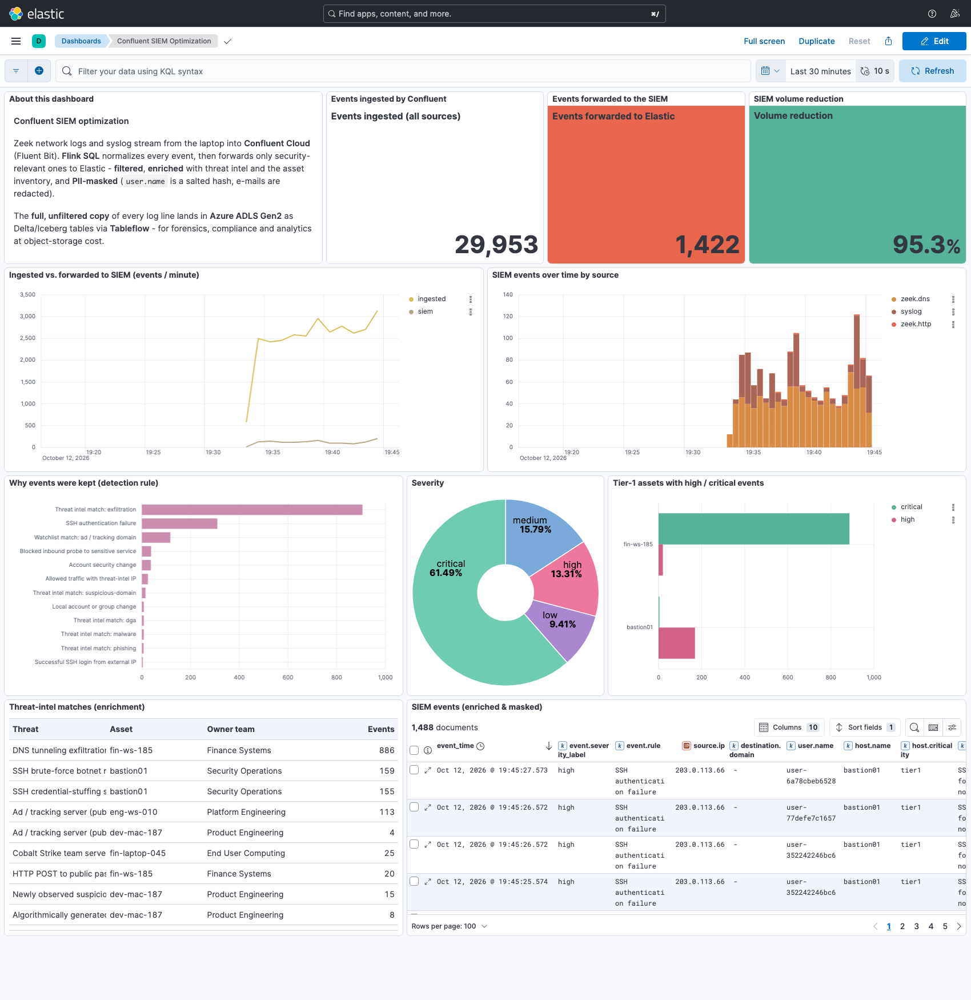

# Confluent SIEM Optimization Demo

Stream security logs from a laptop into **Confluent Cloud**, use **Flink SQL** to cut the SIEM
feed by ~95% while making every alert richer, send that curated feed to **Elastic** with
Confluent's **Elasticsearch Sink connector**, and keep a full copy of every log line as
**Apache Iceberg** tables with **Tableflow** (Confluent-managed storage, so no cloud account of your own is needed).

Inspired by [confluentinc/demo-siem-optimization](https://github.com/confluentinc/demo-siem-optimization).
Provisioned with Terraform, and runs natively on Apple Silicon.



---

## Architecture

```
 LAPTOP (Docker)                              CONFLUENT CLOUD                                      LAPTOP (Docker)
 ───────────────                              ──────────────────────────────                       ───────────────
 Zeek ── replays public pcap ─┐
   conn / dns / http (JSON)   │   Fluent Bit   ┌─ zeek_conn_raw ─┐   Flink: NORMALIZE   ┌─ zeek_conn ──┐
                              ├──────────────► ├─ zeek_dns_raw  ─┤ ───────────────────► ├─ zeek_dns  ──┼──► TABLEFLOW ──► Iceberg tables
 syslog generator ── UDP ─────┘   (Kafka out)  ├─ zeek_http_raw ─┤   schemaless JSON →  ├─ zeek_http ──┤    (Confluent-managed storage,
   firewall / sshd / sudo /                    └─ syslog_raw    ─┘   Avro + Schema Reg. └─ syslog_events┘    100% of logs, unmasked)
   IAM / account (~40 eps)                                                                    │
                                               threat_intel ─────┐  Flink: FILTER +           ▼
 reference-loader ── Avro ───────────────────► asset_inventory ──┴► ENRICH (temporal joins) + MASK ──► siem_events ──┐
   threat intel + CMDB                                               + volume metrics ────────► pipeline_metrics ─┤
                                                                                                                   │
                                     Kafka Connect (self-managed, laptop) ◄── Elasticsearch Sink connector ◄───────┘
                                                │
                                                ▼
                                   Elasticsearch + Kibana (SIEM)              lake-query (DuckDB) ◄── Iceberg REST catalog
```

| Where | Component | Notes |
|---|---|---|
| Laptop | `zeek` | Zeek 8.0 LTS sniffs a dummy NIC fed by `tcpreplay`, which loops the reference repo's public 42-minute "exfiltration exercise" capture |
| Laptop | `syslog-generator` | Synthetic RFC3164 firewall, sshd, sudo, IAM and account-service logs. About 97% noise, plus scripted attacks |
| Laptop | `fluent-bit` | Tails the Zeek logs, receives syslog over UDP 5140, produces to Confluent Cloud (SASL_SSL) |
| Laptop | `reference-loader` | Loads threat intel (curated indicators plus the public ad/tracker watchlist, about 9.5k rows) and the asset inventory as Avro |
| Laptop | `connect` | Self-managed Kafka Connect 7.9 running the **Confluent Elasticsearch Sink connector 15.1**. Its state lives in Confluent Cloud |
| Laptop | `elasticsearch`, `kibana` | 8.19, single node, plus a pre-built dashboard |
| Laptop | `lake-query` | DuckDB reads the Tableflow Iceberg tables through Tableflow's Iceberg REST catalog |
| Cloud | Confluent Cloud | Environment, **Standard** cluster, Schema Registry, Flink compute pool, 6 Flink statements, Tableflow on Confluent-managed storage. All names carry the [demo id](#demo-id). |

## The three use cases

All stream processing is **Flink SQL** in Confluent Cloud ([`flink/`](flink/)).

| # | Use case | What Flink does | Where |
|---|---|---|---|
| 1 | **Filter: thousands of events down to a few** | Drops routine firewall ACCEPTs, background-noise DROPs, cron, systemd, NTP, health checks, internal key-based SSH logins, routine sudo, and normal DNS and HTTP. Keeps threat-intel hits, DNS tunneling, SSH brute force, external logins, account changes, probes to sensitive ports, large outbound transfers and web attacks. | [`dml/1x_siem_*.sql`](flink/dml) |
| 2 | **Enrich** | Event-time **temporal joins** against `threat_intel` (matched on IP, exact domain and registered domain) and `asset_inventory` (matched on IP or hostname). Adds the threat name, category, confidence and geo, plus the asset's owner team, department, criticality and zone. Severity comes from the rule and the intel together. | same files |
| 3 | **Mask / normalize** | Parses unstructured syslog text with regular expressions, maps every source to one Elastic Common Schema-style record, **pseudonymizes `user.name`** (salted SHA-256, so it stays correlatable), and redacts e-mails, user names and credentials in messages and URLs. The lake keeps the unmasked originals for governed forensics. | [`dml/01_normalize_raw_logs.sql`](flink/dml/01_normalize_raw_logs.sql), [`dml/13_siem_syslog.sql`](flink/dml/13_siem_syslog.sql) |
| + | **Prove the value** | Per-minute ingested vs. forwarded counts go to `pipeline_metrics`. Kibana turns them into the "SIEM volume reduction" tile. | [`dml/20_volume_metrics.sql`](flink/dml/20_volume_metrics.sql) |

**Measured on Confluent Cloud:** about **3,000 events/min ingested**, with **~96% fewer events forwarded to the SIEM**. After a few hours, the Iceberg tables held 320,855 events and Elastic held 12,531, or 3.9% of the volume. The forwarded stream includes these detections:

- **DNS tunneling exfiltration** from `fin-ws-185` (base64 sub-domains of `mrhaha.net`)
- **HTTP exfiltration** to `ptsv2.com`
- **55 MB raw-TCP transfer** with `109.238.11.185`, reported every 5 MB (first report about 7 minutes into each 42-minute loop)
- **Outbound connections on non-standard ports**, about 19 per loop (for example TCP/444, Teredo UDP/3544)
- **SSH brute force**, followed by a successful login, `sudo`, and a backdoor account on `bastion01`
- **C2 beaconing** from `fin-laptop-045`
- Phishing, DGA and ad-tracker domains, and port-scan probes

---

## Prerequisites

### Laptop
- macOS (Apple Silicon or Intel) or Linux, with **Docker Desktop allowed ~6 GB of memory**. The stack uses about 4.5 GB, and every image is native arm64.
- `terraform` ≥ 1.5, `python3`, `curl`. Run `./scripts/00-check-prereqs.sh` to check.
- About 1.5 GB of disk for the pcap and images.

### Demo id

Every run gets a short unique **demo id**, for example `k3x9q2`. It's appended to every resource name, so one
demo's resources are easy to find, audit and delete later:

| Resource | Name |
|---|---|
| Environment (when Terraform creates it) | `siem-demo-<id>` |
| Kafka cluster | `siem-demo-<id>` |
| Flink compute pool / statements | `siem-<id>-pool`, `siem-<id>-normalize`, `siem-<id>-siem-dns`, ... |
| API keys (owned by the bootstrap service account) | `siem-<id>-kafka`, `siem-<id>-schema-registry`, `siem-<id>-flink`, `siem-<id>-tableflow` |
| Kafka Connect group / internal topics | `siem-<id>-connect`, `_siem-<id>-connect-*` |
| Bootstrap service account (you create it) | suggested: `siem-demo-<id>-admin` |

`./scripts/00-check-prereqs.sh` generates the id on first run and saves it as `DEMO_ID` in `demo.properties`.
You can also set your own (3–12 lowercase letters or digits). Keep it for the life of the demo, because teardown
uses it to find the resources.

```bash
cp demo.properties.example demo.properties
./scripts/00-check-prereqs.sh        # prints e.g. "DEMO_ID=k3x9q2 ... suggested service account name: siem-demo-k3x9q2-admin"
```

### Confluent Cloud: bootstrap service account

Create **one** service account. Terraform uses it to create everything else, and it owns every API key the demo uses.

**1. Decide which role the service account needs**

| `CC_ENVIRONMENT_ID` in `demo.properties` | Role binding needed | Why |
|---|---|---|
| **empty**: Terraform creates `siem-demo-<id>` | **OrganizationAdmin** | Creating an environment is an organization-level action. EnvironmentAdmin is scoped to an environment that already exists, so it can't create one. |
| **`env-xxxxx`**: you created the environment | **EnvironmentAdmin** on that environment | Enough to create the Standard cluster, Flink pool, topics, statements and Tableflow |

<details open>
<summary><b>Option A: Confluent Cloud Console (GUI)</b></summary>

1. *(Only if you reuse an environment.)* **Environments → + Add cloud environment**. Name it `siem-demo-<id>`,
   choose the **Essentials** Stream Governance package, and click **Create**. Copy the `env-…` id into `CC_ENVIRONMENT_ID`.
   See [Manage environments](https://docs.confluent.io/cloud/current/security/access-control/environments/manage-environments.html).
2. **Create the service account.** Open the sidebar, then **Accounts & access → Service accounts → + Add service account**.
   - Name `siem-demo-<id>-admin`, with a description such as *SIEM optimization demo &lt;id&gt; (Terraform)*.
   - Optionally assign yourself as the owner (ResourceOwner role), then click **Next**.
   - On the **Access** step, assign **OrganizationAdmin** on the organization (new environment), or
     **EnvironmentAdmin** on your environment (existing environment). Click **Next**, then **Create service account**.
   - Copy the `sa-…` id into `CC_SERVICE_ACCOUNT_ID`.
   - See [Create service accounts](https://docs.confluent.io/cloud/current/security/authenticate/workload-identities/service-accounts/create-service-accounts.html).
   - To change roles later: **Accounts & access → Service accounts → (the account) → Access → + Add role assignment**.
     See [Manage role bindings](https://docs.confluent.io/cloud/current/security/access-control/rbac/manage-role-bindings.html)
     and [Predefined RBAC roles](https://docs.confluent.io/cloud/current/security/access-control/rbac/predefined-rbac-roles.html).
3. **Create the Cloud API key.** Go to **API keys** (<https://confluent.cloud/settings/api-keys>) → **+ Add API key**.
   - Choose **Service account** and select `siem-demo-<id>-admin`, then click **Next**.
   - For the resource scope, choose **Cloud resource management**, then click **Next**.
   - Name it `siem-<id>-terraform` and click **Create API key**.
   - Copy the key and secret into `CC_CLOUD_API_KEY` and `CC_CLOUD_API_SECRET`. The secret is shown only once.
   - See [Manage API keys](https://docs.confluent.io/cloud/current/security/authenticate/workload-identities/service-accounts/api-keys/manage-api-keys.html).
     Creating a key for a service account requires OrganizationAdmin, or ResourceOwner on that service account.

</details>

<details>
<summary><b>Option B: Confluent CLI</b></summary>

```bash
ID=<demo id>
confluent login
confluent iam service-account create siem-demo-$ID-admin --description "SIEM optimization demo $ID (Terraform)"
#   -> sa-abc123

# A) Terraform creates the environment
confluent iam rbac role-binding create --principal User:sa-abc123 --role OrganizationAdmin

# B) or reuse an environment you create
confluent environment create siem-demo-$ID --governance-package essentials          # -> env-xyz789
confluent iam rbac role-binding create --principal User:sa-abc123 --role EnvironmentAdmin --environment env-xyz789

confluent api-key create --resource cloud --service-account sa-abc123 --description "siem-$ID-terraform"
```

</details>

### Tableflow API key (EnvironmentAdmin service accounts)

With **OrganizationAdmin**, Terraform creates the Tableflow API key itself, so you can skip this step.
An **EnvironmentAdmin** service account can create the Kafka, Schema Registry and Flink keys, but gets
`403 Forbidden` on the Tableflow key. In that case, create the key yourself (you need OrganizationAdmin, or
ResourceOwner on the service account) and put it in `demo.properties`:

1. Console: **API keys** (<https://confluent.cloud/settings/api-keys>) → **+ Add API key**.
2. Choose **Service account** and select `siem-demo-<id>-admin`, then click **Next**.
3. For the resource scope, choose **Tableflow**. Click **Next**, name the key `siem-<id>-tableflow`, then click **Create API key**.
4. Copy the key and secret into `TABLEFLOW_API_KEY` and `TABLEFLOW_API_SECRET`, then re-run `./scripts/01-provision-cloud.sh`.

The same key is used to manage Tableflow topics and to query the Iceberg REST catalog (`lake-query`).
CLI equivalent: `confluent api-key create --resource tableflow --service-account sa-abc123 --description siem-<id>-tableflow`.
See [Manage API keys](https://docs.confluent.io/cloud/current/security/authenticate/workload-identities/service-accounts/api-keys/manage-api-keys.html).

Alternatively, give the service account **ResourceOwner** on itself (**Service accounts → (account) → Access →
+ Add role assignment**) and leave the properties empty.

No other cloud account is needed. Tableflow writes to **Confluent-managed storage**.

## Configure

Fill in `demo.properties`: `CC_SERVICE_ACCOUNT_ID`, `CC_CLOUD_API_KEY`, `CC_CLOUD_API_SECRET`, optionally `CC_ENVIRONMENT_ID`,
and `CC_CLOUD` / `CC_REGION`. Every input is documented in [`demo.properties.example`](demo.properties.example).

`CC_CLOUD` defaults to **AWS** (`us-east-2`), and **Azure** has been verified end to end (including `lake-query`).
GCP should also work for the cluster, Flink and Tableflow. `lake-query` follows Confluent's
[DuckDB + Tableflow guide](https://docs.confluent.io/cloud/current/topics/tableflow/how-to-guides/query-engines/query-with-duckdb.html).
On Azure it also loads DuckDB's `azure` extension with the curl transport, because Confluent-managed storage there is ADLS.

## Run

```bash
./scripts/00-check-prereqs.sh
./scripts/01-provision-cloud.sh      # Terraform: Confluent Cloud (~10 min), writes docker/.env
./scripts/02-start-local.sh          # downloads pcap once (~1 GB), builds images, starts everything
./scripts/05-status.sh               # containers, connector state, Elastic doc counts
```

Open **Kibana → Confluent SIEM Optimization**: <http://localhost:5601/app/dashboards#/view/siem-optimization>.
Alerts appear within about 1–2 minutes. The volume tiles fill in as each one-minute window closes.

Tableflow commits Iceberg snapshots every few minutes. After about 10–15 minutes:

```bash
./scripts/03-lake-query.sh                                         # canned forensics/compliance queries
./scripts/03-lake-query.sh "SELECT event_type, COUNT(*) FROM syslog_events GROUP BY 1"
./scripts/06-duckdb-ui.sh                                          # DuckDB UI in the browser: http://localhost:4213
```

`06-duckdb-ui.sh` needs the DuckDB CLI on the Mac (`curl https://install.duckdb.org | sh` or `brew install duckdb`).
It attaches the Tableflow catalog and creates the same four views. Catalog tokens expire after about 30 minutes; type `.exit` and re-run.

---

## Demo talk track (≈15 min)

1. **The problem.** Confluent Cloud UI → topics `syslog_raw` and `zeek_*_raw`: about 3k events/min of mostly noise, all of it billed by the SIEM.
2. **Normalize.** Flink workspace → [`flink/adhoc/demo_queries.sql`](flink/adhoc/demo_queries.sql) queries 1 and 2. Raw, schemaless JSON and free-text syslog become typed, Schema Registry–governed tables.
3. **Filter, enrich, mask.** Open statement `siem-<id>-siem-syslog` or `siem-<id>-siem-dns`. Walk through the three commented sections, then run query 4 to show what actually goes to the SIEM.
4. **The SIEM.** Kibana dashboard:
   - ~96% volume reduction, live
   - the "why kept" rules and threat-intel matches with asset owner and criticality
   - `user.name` shows as `user-3f2a…` and messages read `Failed password for [USER] from …`
5. **Agility.** `./scripts/04-add-threat-indicator.sh` adds the port scanner `198.51.100.200` as an indicator. Within seconds every one of its probes appears in Kibana as *Threat intel match: scanner*. There's no SIEM rule change, no re-indexing and no redeploy. The same can be done with `INSERT INTO threat_intel ...` in Flink (query 5).
6. **Nothing is lost.** `./scripts/03-lake-query.sh` shows 100% of the events in the Iceberg tables, forensics on events the SIEM never received, and governed re-identification of masked users.
7. **The connector.** Kafka Connect REST shows the Elasticsearch Sink connector (`localhost:8083`). The same connector is also available fully managed. The demo runs it self-managed because Elastic is on the laptop.

---

## Repository layout

```
demo.properties.example    all inputs (copy to demo.properties)
scripts/                   00-check-prereqs · 01-provision-cloud · 02-start-local · 03-lake-query ·
                           04-add-threat-indicator · 05-status · 06-duckdb-ui · 99-teardown
terraform/                 confluent.tf (env, Standard cluster, SR, keys, raw topics)
                           flink.tf     (compute pool + every statement, in dependency order)
                           tableflow.tf (Tableflow, Confluent-managed storage, on zeek_conn/dns/http, syslog_events)
flink/ddl/                 table definitions (Avro, watermarks, upsert reference tables)
flink/dml/                 01 normalize · 10-13 SIEM routing (filter + enrich + mask) · 20 metrics
flink/adhoc/               queries for the live demo
docker/docker-compose.yml  laptop stack
docker/zeek/               Zeek + tcpreplay sensor image
docker/fluent-bit/         Fluent Bit pipeline (tail + syslog → Kafka)
docker/tools/              generator, reference loader, SIEM setup, lake query (+ reference CSVs)
docker/connect/            Connect image + Elasticsearch sink config
docker/elastic/            index templates, Kibana dashboard (build_dashboard.py → .ndjson)
```

## Design notes

- **Schemaless in, governed out.** Fluent Bit writes plain JSON. Confluent Cloud exposes schemaless topics as `key`/`val` BYTES, and the normalize statement parses them with `JSON_VALUE` and `REGEXP_EXTRACT` into Avro tables registered in Schema Registry. Tableflow requires schematized topics, which is why it reads the normalized tables.
- **Temporal joins and idle reference data.** Reference tables are upsert tables keyed by indicator or asset. Their watermark is `$rowtime - 1s`, and statements set `sql.tables.scan.idle-timeout = 10 s`, so quiet reference partitions never stall the joins.
- **Masking without backreferences.** Flink's `REGEXP_REPLACE` treats the replacement as a literal string, so `$1` is not substituted. The masking patterns use look-arounds instead.
- **Long-running connections.** Zeek logs a connection only when it ends, and the 55 MB transfer never ends while the
  capture loops. [`long-connections.zeek`](docker/zeek/long-connections.zeek) writes an interim `conn` record each time
  a direction crosses another 5 MB (same `uid`, growing byte counts), so the transfer reaches the SIEM about 12 times per loop.
- **Least privilege.** For simplicity every key is owned by the bootstrap service account. In production, split this into per-workload service accounts: a producer for Fluent Bit, a consumer for the sink, and a Flink runner.

## Troubleshooting

| Symptom | Check |
|---|---|
| `01-provision` fails creating an API key (403) | For the Tableflow key, see [Tableflow API key](#tableflow-api-key-environmentadmin-service-accounts). For other keys, check the service account's role (see the table above). |
| A Flink statement shows FAILED | Fix the cause and re-run `./scripts/01-provision-cloud.sh`. Terraform marks failed statements as tainted and recreates them. |
| Tableflow topic creation fails | The topic needs a schema. Check that the Flink DDL statements `siem-<id>-ddl-*` are COMPLETED, then re-run `./scripts/01-provision-cloud.sh` (it's idempotent). |
| Kibana is empty | `./scripts/05-status.sh`. Then check Confluent Cloud → Flink → statements are RUNNING, and `docker compose logs fluent-bit connect`. |
| Volume tiles are empty but alerts show | Windows close one minute after the last event. Wait 1–2 minutes. |
| `lake-query`: table not queryable yet | Tableflow hasn't committed a snapshot yet. Wait about 10 minutes, then check Confluent Cloud → Topics → Tableflow. DuckDB tokens expire after about 30 minutes, so just re-run the script. |
| Finding a demo's leftovers | Search the Confluent Cloud console for the demo id: environment and cluster `siem-demo-<id>`, API keys and statements `siem-<id>-*`. Schema subjects don't carry the id; see [Teardown](#teardown). |
| Laptop is slow | Lower `SYSLOG_EVENTS_PER_SEC`, or give Docker more memory. |

## Teardown

```bash
./scripts/99-teardown.sh     # stops containers, then (after confirmation) destroys everything for this DEMO_ID
```

Teardown also offers to **hard-delete the Schema Registry subjects** the Flink tables registered
(`zeek_conn-key/-value`, `syslog_events-*`, `siem_events-value`, `threat_intel-*`, ...). Flink creates them, not
Terraform, and they belong to the environment's Schema Registry, so `terraform destroy` alone leaves them behind.
Answer **n** if another demo is still running in the same environment, because the subject names are shared.

Leftover subjects from an earlier teardown (its Schema Registry key is already gone) can be removed with the
Confluent CLI, logged in as a user with access to the environment:

```bash
python3 scripts/delete_schemas.py --print-cli env-xxxxx      # prints soft + permanent delete commands
python3 scripts/delete_schemas.py --print-cli env-xxxxx | sh # or run them directly
```

The Standard cluster, Flink CFUs and Tableflow are billed while they run. Tear down after the demo.
Teardown keeps your bootstrap service account, its Cloud API key, any Tableflow API key you created, and an environment
you created yourself (`CC_ENVIRONMENT_ID`). Delete those by hand when you no longer need them.

## Re-running

| Goal | Steps |
|---|---|
| **Run again with the same setup** (e.g. after a laptop reboot, or a failed apply) | `./scripts/01-provision-cloud.sh`, then `./scripts/02-start-local.sh`. Both are idempotent: with the same `DEMO_ID`, Terraform finds and reuses the existing resources and only creates what's missing. |
| **Fresh setup with a new demo id** | `./scripts/99-teardown.sh` and answer **y** to *clear DEMO_ID*. Then run `./scripts/00-check-prereqs.sh`, which generates a new id, followed by `01` and `02`. Your service account and keys in `demo.properties` are reused. |
| **Start from a fresh clone** | `git clone …`, then `cp demo.properties.example demo.properties`, fill in the Confluent Cloud inputs, and follow [Run](#run). The pcap is downloaded again into `data/` (~1 GB). |
| **Reset only the laptop side** | `docker compose --project-directory docker down -v`, then `./scripts/02-start-local.sh`. Elastic, Kibana and Connect are recreated from scratch, and the sink re-reads `siem_events` from the beginning. |

Local files that are never committed (see [`.gitignore`](.gitignore)): `demo.properties` (your inputs),
`docker/.env` (generated, contains API secrets), `terraform/terraform.tfstate*` (the state of the current demo,
which also contains secrets, so keep it until teardown), and `data/` (the pcap).

## Data sources and attribution

- Zeek capture: public `zeek_streamer.pcap` used by [confluentinc/demo-siem-optimization](https://github.com/confluentinc/demo-siem-optimization). Downloaded at runtime.
- Ad/tracker watchlist: `ad_servers.csv` from the same repo (MVPS hosts list). Downloaded at runtime.
- The threat-intel attributions on real IPs and domains are **illustrative demo labels** based on behavior in the capture. They are not real-world verdicts. Synthetic attacker IPs come from RFC 5737 documentation ranges (`192.0.2.0/24`, `198.51.100.0/24`, `203.0.113.0/24`).
